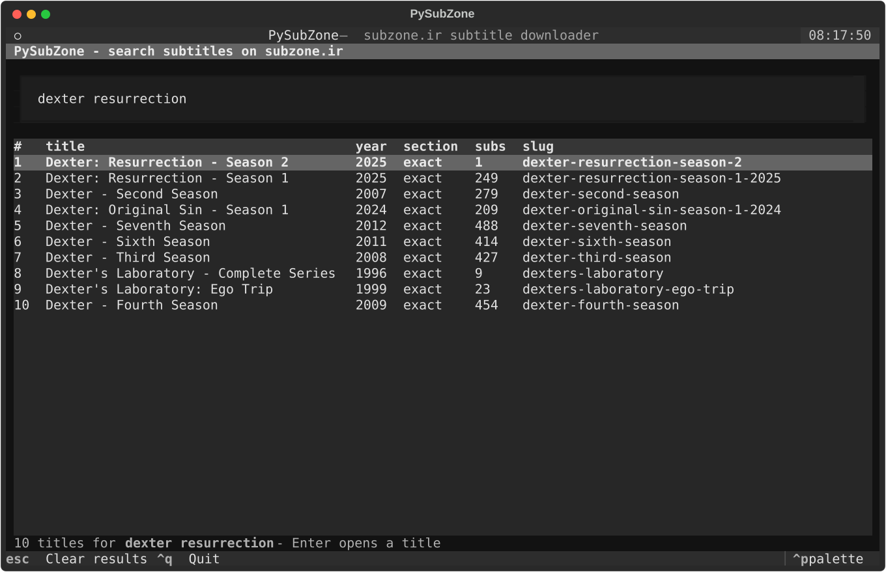
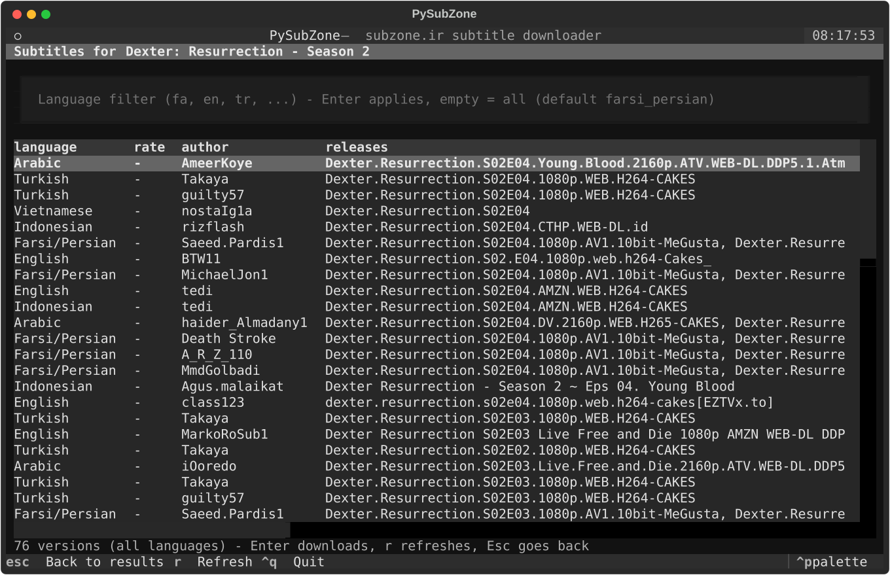
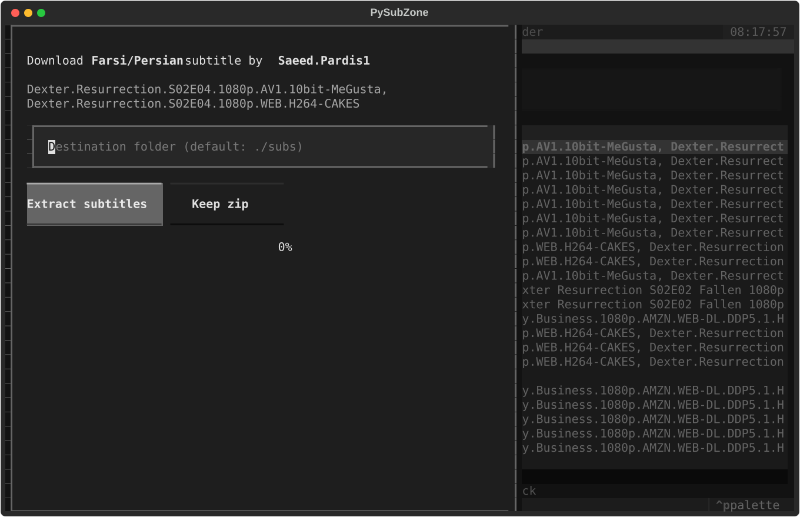

# PySubZone

<p align="center">
  <strong>Find the right subtitle. Download it. Get back to watching.</strong>
</p>

<p align="center">
  <a href="https://pypi.org/project/pysubzone/"></a>
  <a href="https://pypi.org/project/pysubzone/"></a>
  <a href="https://github.com/mackeos/PySubZone/blob/master/LICENSE"></a>
</p>

**PySubZone** is a Python library, command-line tool, and interactive terminal app for searching and downloading subtitles from [SubZone](https://subzone.ir/), the Subf2m subtitle database.

Whether you need one subtitle or want to match subtitles for an entire video collection, PySubZone gives you a straightforward way to find the version that fits.

Inspired by [PyAddic7](https://github.com/mackeos/PyAddic7), which works with addic7ed.com.

## What can it do?

- **Search titles** — find movies and TV shows.
- **Browse subtitle versions** — see the uploads available for a title, with language filtering.
- **Download subtitles** — download a specific upload by reference or URL, or grab the newest uploads from a title page.
- **Match video files automatically** — search for suitable subtitles based on release names, including episode number, resolution, source, and release group.
- **Discover languages** — list every language the engine understands, with aliases and short codes.
- **Script it** — every command speaks `--json`, `subz auto` can export a full result map, and the API ships type hints (`py.typed`) plus an async client.
- **Stay polite** — built-in rate limiting and page caching keep request traffic friendly to the site.
- **Use it your way** — choose the Python API, the command-line interface, or the interactive terminal UI.

The CLI is built with [Typer](https://typer.tiangolo.com/) and Rich, while the interactive TUI is powered by [Textual](https://github.com/Textualize/textual).

> **A note on responsible use:** PySubZone accesses a public website for personal use. Please keep request rates reasonable and respect the source website's terms. Do not redistribute downloaded subtitles.

## Packages

| Package | Purpose | PyPI |
|---|---|---|
| **PySubZone** (`pysubzone`) | Main Python API, CLI, and TUI package | [pypi.org/project/pysubzone](https://pypi.org/project/pysubzone/) |
| **PySubF2M** (`pysubf2m`) | Compatibility package | coming soon |

## Installation

Python **3.9 or newer** is required.

Install the main package with pip:

```bash
pip install pysubzone
```

Or use [pipx](https://pipx.pypa.io/) to install the command-line application in an isolated environment:

```bash
pipx install pysubzone
```

A compatibility package, **PySubF2M** (`pysubf2m`), is planned as a separate release.

After installing PySubZone, the `subz` command is available. You can also run it with:

```bash
python -m pysubzone
```

## Quick start

Search for a title, inspect its subtitle versions, and download one:

```bash
# Search for a movie or show
subz search "dexter resurrection"

# Show the available Farsi subtitle versions
subz versions dexter-resurrection-season-2 -l fa

# Download a specific version
subz download dexter-resurrection-season-2/farsi_persian/3770171
```

## Command-line reference

```text
subz search QUERY [-l LANG] [--json]          Search titles
subz versions TITLE [-l LANG] [--json]        List subtitle uploads
subz title TITLE [--json]                     Title details + language overview
subz download REF [-o DIR] [--zip] [--json]   Download by reference, URL, or slug
subz url URL [-l LANG] [-n N] [--zip]         Download from a SubZone URL
subz filename FILE [-l LANG] [--no-download]  Find the best subtitle for one video
            [--min-score N]
subz auto PATH [-l LANG] [-o DIR] [--out-cwd]    Match videos in a folder
            [--min-score N] [--parallel 1-8] [--map-json FILE|-]
subz popular [--mode popular|latest]           Browse popular or latest uploads
            [-t all|film|series|music] [-p PAGE]
subz languages [--json]                        List known languages + aliases
subz config show|set|unset|path               Manage the config file
subz tui                                       Open the interactive interface
```

Global options:

- `--base-url` — use a different base URL.
- `--user-agent` — set the HTTP user agent.
- `--timeout` — configure the request timeout.
- `--retries` — configure retry attempts.
- `--min-interval` — minimum seconds between HTTP requests (politeness rate limit).
- `--cache-ttl` — seconds to keep fetched pages in an in-memory cache.
- `-v`, `--verbose` — enable verbose output.

Every data command supports `--json` for scripting and automation.

Exit codes follow the PyAddic7 contract:

| Code | Meaning |
|---:|---|
| `0` | Success |
| `1` | Nothing found |
| `2` | Error |

### Search and browse

```bash
# Search for a title
subz search "dexter resurrection"

# Search for titles with Farsi subtitles
subz search odyssey -l fa

# List Farsi subtitle versions for a title
subz versions dexter-resurrection-season-2 -l fa

# Title details: year, IMDb id and which languages have subtitles
subz title dexter-resurrection-season-2
subz title "dexter resurrection" --json

# Every language the engine understands, with short codes and aliases
subz languages
subz languages --json

# Browse popular movie uploads
subz popular -t film

# Browse the latest series uploads, page 2
subz popular --mode latest -t series -p 2
```

### Download subtitles

A **reference** identifies one subtitle upload and follows this format:

```text
<slug>/<lang>/<id>
```

You can copy a reference from a version listing.

```bash
# Download using a reference
subz download dexter-resurrection-season-2/farsi_persian/3770171

# Download using the full subtitle URL
subz download https://subzone.ir/subtitles/dexter-resurrection-season-2/farsi_persian/3770171

# Grab the two newest Farsi uploads from a title URL
subz url https://subzone.ir/subtitles/the-odyssey-2026 -l fa -n 2

# The language can also come straight from a language page URL
subz url https://subzone.ir/subtitles/arcane-league-of-legends-first-season/farsi_persian -n 3

# Grab all available uploads from that title URL
subz url https://subzone.ir/subtitles/the-odyssey-2026 -l fa -n 0

# Download by title slug
subz download the-odyssey-2026 -l en --zip --out ./downloads
```

By default, downloaded archives are **extracted** and subtitle files receive a language suffix, such as `Movie.fa.srt` (or retain the release name when the archive includes one).

When a multi-version grab hits a **stale upload** whose CDN file is gone (HTTP 404 or an S3 `NoSuchKey` response), that version is skipped with a warning and the rest of the grab continues; the command fails only when every requested version is dead.

Useful output options:

- `--zip` — keep the original archive instead of extracting it.
- `--no-suffix` — do not append a language suffix.
- `--lang-suffix XX` — choose a custom language suffix.
- `-o DIR` / `--out DIR` — choose the output directory.

### Automatically match a video collection

PySubZone can inspect video release names, search the site, score available subtitle versions, and download the best match.

```bash
# Find a subtitle for one video
subz filename "Dexter.Resurrection.S02E01.1080p.AMZN.WEB-DL-NTb.mkv"

# Preview matches in a folder without downloading
subz auto /media/shows -l fa --dry-run

# Download and extract subtitles beside the videos
subz auto /media/shows -l fa

# Save subtitles into a "subs" folder inside the videos folder
subz auto /media/shows -l fa -o subs

# Old behavior: resolve a relative output folder against the current directory
subz auto /media/shows -l fa -o subs --out-cwd
```

For each video, the release name is parsed for details such as the title, season and episode, resolution, source, and release group. Subtitle versions are rejected when their season disagrees with the video's (word forms like "Complete First Season" or "فصل دوم" count too), when their explicit episode span does not cover the video (an act pack `S02E01-E03` matches episodes 1-3 only), or when pinned episode numbers conflict. Exact release matches are preferred, and season packs of the *same* season can be used as fallbacks.

Multi-episode packs are handled member-aware: when the video pins an episode (`SxxEyy`) and the chosen upload is a pack whose member files carry their own episode tags (an `E01-E03` zip containing `...E01.srt`, `...E02.srt`, `...E03.srt`), extraction writes only the member matching the video - one correctly named file instead of three numbered copies that all carry the video's name. Untagged members, movies and season-folder videos keep the previous numbered behavior, and `--zip` mode always stores the full original archive.

The output folder is controlled by `-o/--out`. A **relative** path is created **inside the videos folder** (each video's own folder), so `-o subs` collects subtitles in a `subs` folder next to the videos. An **absolute** path is used exactly as given. Without `-o`, subtitles are saved beside each video. To resolve relative paths against the current directory instead (the behavior up to v0.1.1), pass `--out-cwd`.

Quality and speed controls:

- `--min-score N` — only download a match when its score is at least `N` (0-100). Lower-scoring videos are reported as `skipped` in the summary but never abort the run. The default (`0`) accepts every best match, exactly like earlier releases.
- `--parallel N` (or `-w`) — download for up to `N` videos concurrently (1-8). The default is sequential.

Both options can also be set permanently in the [config file](#configuration-file) as `defaults.min-score` and `defaults.workers`.

- `--prefer-complete` — opt-in batch mode: when one same-season pack covers **every** episode video in the folder (e.g. a `COMPLETE` season zip whose release lines name the folder's season), it is preferred for all of them and each video still receives its own episode extracted and renamed. Movies and videos without a pinned season/episode are never touched. Off by default; set permanently as `defaults.prefer-complete`.

For scripting, `--map-json` writes the complete per-video result map — every match, score, status and saved path, plus a summary — as JSON:

```bash
# Write the map to a file (same shape as --json, plus a summary object)
subz auto /media/shows -l fa --map-json results.json

# Or print the map to stdout instead of the table
subz auto /media/shows -l fa --map-json -
```

The JSON contains `results` (one object per video: `video`, `title`, `ref`, `score`, `status`, `saved`/`error`) and a `summary` (`total`, `ok`, `skipped`, `not found`, `dry-run`, `error` counts), together with the run's `language`, `min_score`, `workers` and `dry_run` settings.

A failed match does not stop the whole collection: unsuccessful files are included in the final summary.

### Configuration file

Every command falls back to values stored in a small TOML file when the matching option is not given. Inspect and manage it from the CLI:

```bash
subz config path                 # print the file location
subz config show                 # list every stored value
subz config set defaults.language fa
subz config set defaults.min-score 60
subz config set defaults.workers 4
subz config set defaults.zip true
subz config unset defaults.zip   # fall back to the built-in default
```

The file lives at `~/.config/pysubzone/config.toml` on Linux, `~/Library/Application Support/pysubzone/config.toml` on macOS, and `%APPDATA%\\pysubzone\\config.toml` on Windows. Set the `PYSUBZONE_CONFIG` environment variable to use a different location.

Available keys:

| Key | Type | Effect |
|---|---|---|
| `defaults.language` | text | Default `-l/--lang` language (fa, en, tr, ...) |
| `defaults.out` | text | Default `-o/--out` output folder |
| `defaults.zip` | true/false | Keep archives instead of extracting (`--zip`) |
| `defaults.lang-suffix` | text | Custom language suffix for extracted files |
| `defaults.no-suffix` | true/false | Name files `Movie.srt` instead of `Movie.fa.srt` |
| `defaults.min-score` | integer 0-100 | Minimum auto-match score |
| `defaults.workers` | integer 1-8 | Parallel downloads for `subz auto` |
| `network.base-url` | text | Site base URL |
| `network.user-agent` | text | HTTP User-Agent header |
| `network.timeout` | number | HTTP timeout in seconds |
| `network.retries` | integer 0-10 | Retries per request |
| `network.verbose` | true/false | Log HTTP requests |
| `network.min-interval` | number 0-60 | Minimum seconds between HTTP requests (rate limit) |
| `network.cache-ttl` | number 0-3600 | Seconds to cache fetched pages in memory |

Command-line flags always win: an option given on the command line overrides the config file, which overrides the built-in default.

## Interactive terminal interface

Prefer an interactive experience? Run:

```bash
subz tui
```

The TUI covers everything the CLI can do:

1. **Search** — enter a query to see matching titles.
2. **Versions** — select a title to browse its uploads, filter by language.
3. **Download dialog** — pick a destination folder, optionally rename the output file in the *Save as* field, and choose to extract subtitles or keep the ZIP archive. A live progress bar tracks the download.
4. **Auto-match** (`Ctrl+A`, works from any screen) — the `subz auto` flow: enter a folder, then dry-run or download matching subtitles for every video it contains. A relative output folder (e.g. `subs`) is created inside the videos folder, just like `subz auto -o`. Selecting a matched row opens that title's version list so you can pick another upload; selecting a failed row shows why it failed.
5. **Browse** (`Ctrl+B`) — the `subz popular` flow: page through popular and latest uploads, filter by media type, and download directly.

The last destination folder and language filter are remembered between sessions (stored as `settings.json` next to the config file), so the download dialog and auto-match screen come back pre-filled.

**Keyboard shortcuts**

| Key | Action |
|---|---|
| `Ctrl+S` | Search screen |
| `Ctrl+A` | Auto-match screen (works everywhere, even while typing) |
| `Ctrl+B` | Browse screen |
| `Esc` | Go back or close the current view |
| `r` | Refresh versions / re-scan the folder |
| `p` / `l` | Browse: popular / latest uploads |
| `Left` / `Right` | Browse: previous / next page |
| `Ctrl+Q` | Quit |

The header always shows the running version next to the tagline (e.g. *PySubZone — subzone.ir subtitle downloader — v0.4.2*).

### TUI screenshots

| Search | Subtitle versions | Download |
|---|---|---|
|  |  |  |

## Python API

You can use PySubZone directly from your own Python projects:

```python
from pysubzone import SubZoneClient

client = SubZoneClient(timeout=20)

# Search for titles
results = client.search("dexter resurrection")

# Find a title and list its Farsi subtitle versions
title = client.search_exact("Dexter Resurrection")
versions = client.title_versions(title.slug, "farsi_persian")

# Download the first version and extract it into ./subs
result = client.download(
    versions[0],
    dest_dir="subs",
    save_mode="extract",
)
print(result.srt_paths)

# Find the best subtitle for a video release name
best_title, version, score = client.best_for_file(
    "Breaking.Bad.S05E14.720p.BluRay.x264-DEMAND"
)

# Download the match and associate it with the video filename
client.download(
    version,
    dest_dir=".",
    save_mode="extract",
    target_video="Breaking.Bad.S05E14.mkv",
)

# Same download, but rename the output files yourself
client.download(
    version,
    dest_dir="subs",
    save_mode="extract",
    base_name="My Show S05E14",   # -> subs/My Show S05E14.fa.srt
)

# Download from a SubZone title URL
client.download_url(
    "/subtitles/the-odyssey-2026",
    lang="fa",
    limit=1,
    dest_dir="subs",
)

# Batch-download several versions; failures come back as exceptions,
# one bad item never aborts the rest of the batch
results = client.download_many(
    ["dexter-resurrection-season-2/farsi_persian/3770171",
     "the-odyssey-2026/farsi_persian/3768757"],
    dest_dir="subs",
    max_workers=2,                          # 1 = sequential (default)
    on_result=lambda index, outcome: print(index, outcome),
)
for result in results:
    if isinstance(result, Exception):
        print("failed:", result)
```

### Tuning the match score

The auto-match ranking is built from weighted components (resolution, source, release group, token overlap, ...). Pass a `ScoreWeights` instance to emphasize what matters for your library:

```python
from pysubzone import ScoreWeights, SubZoneClient

client = SubZoneClient()

# Release-group agreement matters more than resolution here
weights = ScoreWeights(resolution_match=10, group_match=50)
title, version, score = client.best_for_file(
    "Show.S01E01.1080p.WEB-DL-NTb",
    lang="fa",
    weights=weights,
)
```

`ScoreWeights()` with no arguments reproduces the built-in ranking exactly. The episode-mismatch hard reject is not a weight and always applies.

### Rate limiting and caching

Two client options keep traffic friendly and fast — useful for long `auto` runs and batch scripts:

```python
client = SubZoneClient(
    min_request_interval=0.5,   # >= 0.5s between HTTP requests
    cache_ttl=300,              # cache fetched pages for 5 minutes
    cache_size=256,             # pages kept in memory
)
```

Cached pages are returned instantly until they expire (`clear_cache()` drops them; downloads are never cached). The same values can be set globally via `--min-interval` / `--cache-ttl` or the `network.min-interval` / `network.cache-ttl` config keys.

### Async client

`AsyncSubZoneClient` mirrors the full synchronous API and offloads every call to a worker thread, so it never blocks your event loop while still reusing the same scraping, retry, rate-limit and cache logic:

```python
import asyncio
from pysubzone import AsyncSubZoneClient

async def main():
    async with AsyncSubZoneClient(min_request_interval=0.5, cache_ttl=300) as client:
        results = await client.search("dexter")
        page = await client.title(results[0].slug)
        versions = await client.title_versions(results[0].slug, "fa")
        await client.download(versions[0], dest_dir="subs")

asyncio.run(main())
```

The package ships a `py.typed` marker, so type checkers see the annotations of every public API.

All client exceptions derive from `pysubzone.SubZoneError`. Specific errors include `NetworkError`, `TitleNotFoundError`, `NoSubtitleFoundError`, and `DownloadError`.

## How it works

The project is organized into a few focused modules:

```text
src/pysubzone/
  client.py       HTTP client, retries, rate limiting, page cache, signed-CDN downloads
  async_client.py Async facade over the sync client (asyncio.to_thread)
  parsing.py      Search, title, version, and browse-page parsers
  models.py       Data models with as_dict() support for JSON output
  languages.py    Language slugs and aliases (fa, en, tr, ...)
  matcher.py      Release-name parsing and video-folder scanning
  scoring.py      Subtitle-version scoring for auto-match (ScoreWeights)
  config.py       TOML config file and remembered TUI settings
  cli.py          Typer command-line interface
  tui.py          Textual terminal interface
tests/            Offline tests using saved HTML fixtures
```

### Website endpoints and client methods

| SubZone route | PySubZone method |
|---|---|
| `/subtitles/searchbytitle?query=...` | `search()`, `search_exact()` |
| `/subtitles/<slug>` (optionally `/<lang>`) | `title()`, `title_versions()` |
| `/subtitles/<slug>/<lang>/<id>` | `get_version()` |
| `/subtitles/<slug>/<lang>/<id>/download` | `download()` |
| `/browse/popular|latest/...` | `browse()` |

Downloads follow a redirect to a signed CDN URL. Before saving a download, PySubZone verifies the ZIP file signature. This helps detect stale uploads that return an S3 `NoSuchKey` XML response with HTTP 200; these are reported as `DownloadError` with a hint to try another version.

## Development

Clone the repository, install the project in editable mode with development dependencies, and run the test suite:

```bash
pip install -e ".[dev]"
pytest
```

The test suite is designed to run **offline**. It uses saved HTML fixtures and synthetic release names, so tests do not need to access SubZone.

## Support the project

If PySubZone saves you time or makes subtitle management easier, consider supporting its continued development. Donations are entirely optional — using the project, reporting bugs, sharing feedback, and contributing code are all valuable ways to help.

See **[DONATE.md](https://github.com/mackeos/PySubZone/blob/master/DONATE.md)** for cryptocurrency donation options.

## License

PySubZone is released under the **MIT License**. See [LICENSE](https://github.com/mackeos/PySubZone/blob/master/LICENSE) for the full license text.
